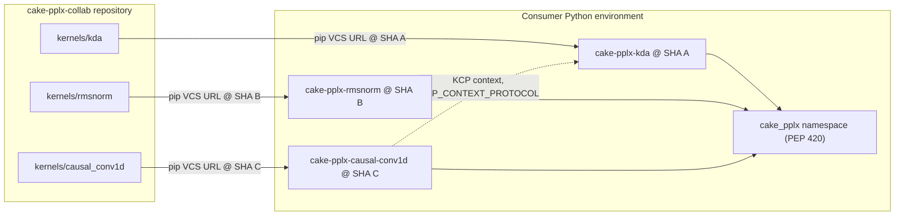

# Cake training kernels: architecture

This repository holds the Cake training kernels for Perplexity. NVIDIA engineers maintain the kernels. Perplexity training engineers use them.

The kernels came from FlashInfer:

- [flashinfer-ai/flashinfer#8928](https://github.com/flashinfer-ai/flashinfer/issues/8928) defined their names.
- [flashinfer-ai/flashinfer#9326](https://github.com/flashinfer-ai/flashinfer/pull/9326) is a draft PR. It removes the kernels from FlashInfer.

The import source is FlashInfer `main` at `c5c39b0e87f027011c86881aa2935a83e1ce53e7`.

## Core requirement

Each kernel family is decoupled from the other families. When you integrate, you can take each family from a different commit.

The rest of this document explains how the repository meets this requirement.

## Terms

| Term | Meaning |
|---|---|
| Family | One operation, for example `kda` or `rmsnorm`. A family is the unit of release. |
| Mode | `det` or `nondet`. The mode is part of the name. No `deterministic=` keyword exists. |
| `det` | Bitwise identical output from run to run. |
| `nondet` | No bitwise promise. At its non-deterministic step, it raises the PyTorch deterministic-algorithms alert. It never falls back to `det`. |
| KCP | Context-parallel route. The suffix is `_kcp`. |
| Facade | Public module `cake_pplx.<module>`. It wraps one backend package. |
| Backend package | `cake_pplx._backends.<module>/`. Holds kernels, `build.json` and `csrc/`. |

The names follow #8928:

- Public module: `cake_<op>_<det|nondet>_train[_kcp]`
- Autograd entry: `cake_<op>_<mode>[_kcp]`

## Repository layout

```
README.md
ARCHITECTURE.md
kernels/
  <family>/
    pyproject.toml  VERSION  README.md  UPSTREAM.json
    cake_pplx/
      cake_<op>_<mode>_train[_kcp].py          # public facades
      _backends/cake_<op>_<mode>_train[_kcp]/  # kernels, build.json, csrc/
    tests/  benchmarks/
integration/<family>/  # tests that need another family, run on a pinned combination
tools/              # check_isolation.py, import_from_flashinfer.py, release helper
.github/workflows/
```

Each `kernels/<family>/` directory is an independent Python distribution named `cake-pplx-<family>`. It has its own `pyproject.toml`, `VERSION`, `README.md`, `UPSTREAM.json`, tests and benchmarks.

The `det`, `nondet` and KCP variants of one family ship together. They share tests and reference code. `det` is the reference for `nondet`.

## Overview



## Family index

The repository has 14 families and 31 backend packages, about 212 MB in total. Most of this is generated CUDA in `csrc/`.

| Family | Backend packages | Distribution |
|---|---|---|
| `rmsnorm` | det, nondet | `cake-pplx-rmsnorm` |
| `rmsnorm_silu_gate` | det, nondet | `cake-pplx-rmsnorm-silu-gate` |
| `causal_conv1d` | det, nondet (each package also holds a KCP route; `_kcp` facades) | `cake-pplx-causal-conv1d` |
| `mhc` | det, nondet | `cake-pplx-mhc` |
| `mhc_head` | det, nondet | `cake-pplx-mhc-head` |
| `gdn` | det, det_kcp, nondet, nondet_kcp | `cake-pplx-gdn` |
| `kda` | det, det_kcp, nondet, nondet_kcp | `cake-pplx-kda` |
| `lm_head` | det, nondet | `cake-pplx-lm-head` |
| `moe_grouped_gemm` | det, nondet | `cake-pplx-moe-grouped-gemm` |
| `dense_gemm` | det, nondet | `cake-pplx-dense-gemm` |
| `dsa_indexer` | det, nondet | `cake-pplx-dsa-indexer` |
| `dsa_sparse_attention` | det, nondet | `cake-pplx-dsa-sparse-attention` |
| `gqa` | det, nondet | `cake-pplx-gqa` |
| `gated_act_mxfp8` | det | `cake-pplx-gated-act-mxfp8` |

pip normalizes `_` and `-` in distribution names. Both spellings resolve to the same distribution.

## Import namespace

`cake_pplx` is a PEP 420 namespace package. Each family adds modules to it:

- Facades: `cake_pplx/<module>.py`
- Backends: `cake_pplx/_backends/<module>/`

Do not add `cake_pplx/__init__.py` or `cake_pplx/_backends/__init__.py`. If you add one, one family takes ownership of the namespace and the other families break.

## Migrating from FlashInfer

The migration only changes the import prefix. The entry-point names stay the #8928 names.

| FlashInfer | cake-pplx-collab |
|---|---|
| `flashinfer.<module>` | `cake_pplx.<module>` |
| `flashinfer.experimental.cake.<module>` | `cake_pplx._backends.<module>` |
| `from flashinfer.cake_kda_nondet_train import cake_kda_nondet` | `from cake_pplx.cake_kda_nondet_train import cake_kda_nondet` |

## Selecting a commit per family

Install each family from its own commit with a pip VCS URL. Use full commit SHAs.

`requirements.txt`:

```text
cake-pplx-kda @ git+https://github.com/perplexityai/cake-pplx-collab@<sha>#subdirectory=kernels/kda
cake-pplx-rmsnorm @ git+https://github.com/perplexityai/cake-pplx-collab@<other-sha>#subdirectory=kernels/rmsnorm
```

pip or uv:

```bash
pip install -r requirements.txt
# or
uv pip install -r requirements.txt
# or add one family to a uv project
uv add "cake-pplx-kda @ git+https://github.com/perplexityai/cake-pplx-collab@<sha>#subdirectory=kernels/kda"
```

Rules:

- One environment can hold only one commit of a family. The distribution name is unique.
- Different families can come from different commits.
- Record the selected SHAs in the lock file of the consumer repository.
- You can also use a family tag `<family>/vX.Y.Z` in place of a SHA.

## Isolation rules

CI enforces these rules with `tools/check_isolation.py` on every PR.

1. The runtime and test code of a family imports only these modules:
   - its own `cake_pplx` modules
   - `torch`, `tvm_ffi`, `numpy`, `pytest`
   - the Python standard library
2. No shared runtime package exists. Each family has its own copy of the small common pieces:
   - the JIT build shim (`_cake_pplx_jit.py` in each backend package; it replaces `flashinfer.jit`)
   - the API decorator that replaces `flashinfer.api_logging.flashinfer_api` (a no-op)
   - `cake_ffi_checks.h`
   - the test helpers

   These copies can diverge.
3. `tools/` at the repository root is only for development. Kernels never import it.
4. Do not add `__init__.py` at the namespace levels.
5. A change in `kernels/<family>/` must not change another family. Use one family per PR. Changes to repo-wide tooling are the exception.

Backend packages already import no other backend package. Kernel sources include only CUDA headers, `tvm_ffi` headers and a local `cake_ffi_checks.h`.

## Cross-family contract: KCP context

There is one cross-family runtime contract. The `causal_conv1d` KCP route consumes the context object that the KDA or GDN KCP `..._build_context` function builds. An example is `CakeKDADetKcpContext`.

- The contract is a documented duck-typed protocol.
- It has a version integer, `KCP_CONTEXT_PROTOCOL`.
- At run time, `causal_conv1d` checks the version. If the version does not match, it raises a clear error.
- Tests that need another family live in `integration/<family>/`, not in `kernels/<family>/tests/`. The import tool moves them there.
- Run them in one environment that has the families they need, each at a chosen commit.

If you change the context shape, increase `KCP_CONTEXT_PROTOCOL`. Then update the consumer side in a separate PR.

## Build and runtime

Runtime dependencies:

- `torch`
- `apache-tvm-ffi>=0.1.11,<0.2`
- CUDA toolkit >= 12.8 with `nvcc`, for JIT builds

Each backend package has these files:

| File | Purpose |
|---|---|
| `build.json` | Self-contained build manifest, schema `cake-build/1`. It lists per-library sources, the sha256 closure, the arch flags (`sm_100a`, `sm_103a`, `sm_107a`), compile and link flags, and the minimum CUDA version. |
| `cake_build.py` | Library loader. It loads `aot/<name>.so` when a builder made it, else builds the library through the JIT shim. |
| `_cake_pplx_jit.py` | JIT shim. It compiles one manifest entry with `nvcc` and caches the result under `$CAKE_PPLX_CACHE_DIR` (default `~/.cache/cake_pplx`). |
| `cake_jit.py` | The package's library registry, used by the backend code. |
| `csrc/` | CUDA sources. |

Build paths:

- **JIT (default).** If no prebuilt `.so` exists, the loader builds from `build.json` the first time you use the kernel. The shim uses exactly the manifest's arch flags, so it never adds a generic `sm_XX` target.
- **AOT (optional).** A builder compiles the manifest into `aot/` and writes `aot/build_info.json`. A per-family wheel builder is planned.

## CI

- Each PR runs the isolation check.
- A path-filtered matrix runs only the families that changed.
- For each changed family, CI installs only that family from the PR head. Then it runs the CPU tests of that family.
- GPU tests and `integration/` tests are not in the GitHub CI yet. Run them on Blackwell machines (`sm_100a`, `sm_103a`, `sm_107a`) before you merge a family change.

## Running tests

Run the tests of a family against the installed distribution, not the source tree. Copy `tests/` (and the `pyproject.toml`) to a directory outside `kernels/<family>/`, then run pytest there.

```bash
pip install "./kernels/kda[test]"
cp -r kernels/kda/tests kernels/kda/pyproject.toml /tmp/kda-tests/
cd /tmp/kda-tests && python -m pytest -p no:cacheprovider tests
```

Run the tests of `integration/<family>/` the same way, in an environment that has every family they import. For example, `integration/causal_conv1d/` needs `kda` and `gdn` too. Tests that need several GPUs start their own processes when one process sees all GPUs. Run them with the `SLURM_*` task variables unset.

## Upstream sync

Each family has an `UPSTREAM.json` file. It records:

- the source FlashInfer commit
- the source paths
- the generator revision from `build.json`

To import a family again, run:

```bash
python tools/import_from_flashinfer.py --family <family> --src <flashinfer checkout> --dest kernels
```

The tool makes only mechanical changes:

1. It copies the family sources.
2. It changes the import paths to `cake_pplx`.
3. It installs the JIT shim and the API decorator.
4. It changes the `package` field in each `build.json`.

It also moves every test that imports another family to `integration/<family>/`, and reports the remaining `flashinfer` references.

A family update has two kinds of commits:

1. One mechanical commit made by the tool. Review it by re-running the tool.
2. Adaptation commits made by hand, for example tests that checked FlashInfer packaging. After a new import, re-apply them with `git cherry-pick` or by hand.

Kernel updates from FlashInfer then land one family at a time.

## Release a family

1. Change only files in `kernels/<family>/`.
2. Increase the version in `kernels/<family>/VERSION`. Increase it only for changes in that directory.
3. Merge the PR after the family CI passes.
4. Tag the merge commit `<family>/vX.Y.Z`. You can use the release helper in `tools/`.
5. Consumers update the SHA or tag for that family. Other family pins do not change.

## Open items

- **GPU CI.** The GPU CI runners are not yet configured, and no CI lane runs `integration/` yet.
- **Architecture coverage.** The first import was validated on GB300 (`sm_103a`) only. `sm_100a` and `sm_107a` are not validated yet.
- **Wheel publication.** We have not decided whether to publish wheels to a package index.
- **KCP context protocol.** The protocol for the `causal_conv1d`/KDA/GDN KCP context begins at version 1.
- **Environment variables.** The kernels keep their `FLASHINFER_*` knob names (for example `FLASHINFER_CAKE_DSA_*`). A rename to `CAKE_PPLX_*` is a later, per-family change.
